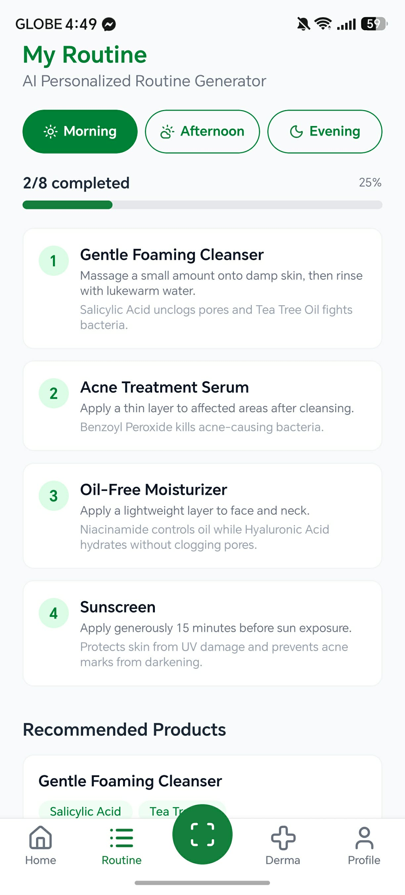
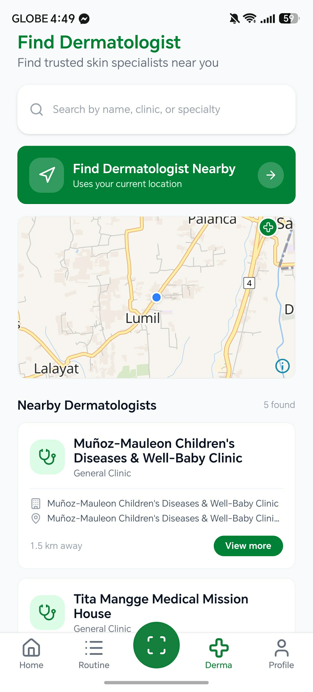
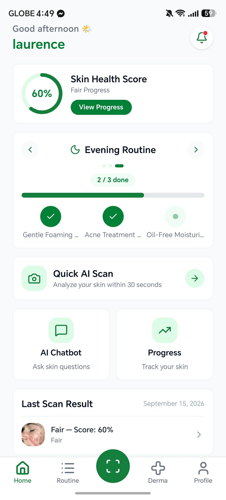

# Skinlens: An Ai-Powered Mobile Application For Detecting Facial Skin Condition With Personalized Skincare Guide


## Features
- **AI Skin Condition Detection** – Analyzes facial images using AI to identify possible skin conditions.
- **Location-Based Dermatologist Finder** – Helps users locate nearby dermatologists based on their area.
- **Personalized Skincare Routine Generation** – Generates a skincare routine based on the user's skin profile and detected condition.
- **Skin Health Report Generation** – Provides a summary of the user's skin scan results and recommendations.
- **Progress Tracking** – Allows users to monitor their skin health and track changes over time.
- **Offline Support** – Provides selected AI-powered features and skincare guidance even without an internet connection.

## Screenshots

<p align="center">
  
  
  
</p>

## Goal

SkinLens aims to provide a **simple, friendly, accessible, and free-to-use** mobile application that helps users understand their facial skin condition, receive personalized skincare guidance, and track their skin progress without requiring paid services.

## Disclaimer

SkinLens is designed for **informational and educational purposes only**. Its AI-generated results and skincare recommendations are **not a medical diagnosis or treatment** and should not replace professional medical advice.

If you have persistent, severe, or worsening skin concerns, please consult a **licensed dermatologist** or healthcare professional.
## Deployment checklist

1. **Database** — run every file in `supabase/migrations/` in order (SQL Editor or `supabase db push`). `0010_security_hardening.sql` is required before release.
2. **Image uploads** — deploy the signing function and set its secrets:
   ```sh
   supabase secrets set CLOUDINARY_CLOUD_NAME=... CLOUDINARY_API_KEY=... CLOUDINARY_API_SECRET=...
   supabase functions deploy cloudinary
   ```
   Then remove `EXPO_PUBLIC_CLOUDINARY_UPLOAD_PRESET` from `.env` / EAS env and disable that unsigned preset in the Cloudinary console.
3. **Crash reporting (optional)** — set `EXPO_PUBLIC_SENTRY_DSN`. For readable stack traces, add the `@sentry/react-native` config plugin with your `organization`/`project` and set `SENTRY_AUTH_TOKEN` as an EAS secret.
4. **Checks** — `npm run typecheck && npm run lint && npm test`.
